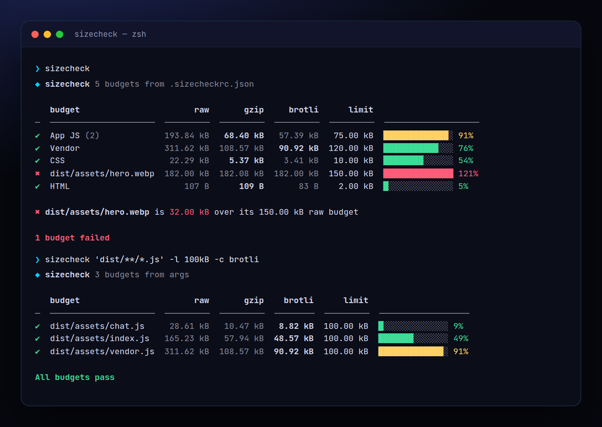

<!-- ═════════════ HEADER ═════════════ -->
<p align="center">
  
</p>

<p align="center">
  
</p>

<p align="center">
  <a href="https://github.com/krishyaa06/prism-size-check/actions/workflows/ci.yml"></a>
  
  
  <a href="LICENSE"></a>
</p>

<p align="center">
  
</p>


## ⚡ Overview

**Prism Size Check** (`sizecheck`) keeps your app fast by giving every bundle a budget. Describe budgets in `.sizecheckrc.json` (or `package.json` → `"sizecheck"`), run it after your build and get a table of raw, gzip and brotli sizes with a progress bar against each limit. It exits with code 1 when something is over budget, so a bloated dependency fails CI instead of slowing down your users.

## ✨ Features

- **Raw, gzip (level 9) and brotli (q11)** sizes for every budget
- **Globs** with `**`, `{a,b}` braces and `!excludes`; directories expand automatically
- **Grouped or per-file** budgets (`"each": true`), choose the compression that counts
- **Baselines**: `--save` stores sizes, later runs show `+/−` deltas
- **Ad-hoc mode**: `sizecheck "dist/**/*.js" -l 50kB` without any config
- `--init` starter config, `--json` output, exit code 1 on failure; zero dependencies

## 🚀 Quick Start

```bash
# run without installing
npx github:krishyaa06/prism-size-check --help

# or install globally
npm install -g github:krishyaa06/prism-size-check
sizecheck "dist/**/*.js" -l 50kB
```

Requires Node.js 18.17+. No dependencies.

## 🛠️ Usage

```text
sizecheck                          check budgets from .sizecheckrc.json / package.json "sizecheck"
sizecheck "dist/**/*.js" -l 50kB   ad-hoc check (each file)
sizecheck --init                   write a starter .sizecheckrc.json

  -l, --limit <size>     budget for ad-hoc patterns (10kB, 1.5MB, 200KiB)
  -c, --compression <c>  gzip (default) | brotli | none
      --total            ad-hoc: sum files instead of checking each
      --save             store current sizes as baseline
      --json             machine-readable output
```

### Config

```json
[
  { "name": "App JS", "path": ["dist/assets/*.js", "!dist/assets/vendor.js"], "limit": "75 kB" },
  { "name": "Vendor", "path": "dist/assets/vendor.js", "limit": "120 kB", "compression": "brotli" },
  { "path": "dist/assets/*.{webp,png,jpg}", "limit": "150 kB", "compression": "none", "each": true }
]
```

### In CI

```yaml
- run: npm run build
- run: npx github:krishyaa06/prism-size-check
```

## 📁 Project Structure

```text
prism-size-check/
├── assets/
│   ├── logo.png
│   └── logo.svg
├── bin/
│   └── sizecheck.js   # CLI entry
├── examples/
│   ├── app/
│   │   ├── dist/
│   │   │   ├── assets/
│   │   │   │   ├── chat.js
│   │   │   │   ├── hero.webp
│   │   │   │   ├── index.js   # globs, gzip/brotli, budgets
│   │   │   │   ├── style.css
│   │   │   │   └── vendor.js
│   │   │   └── index.html
│   │   ├── .gitignore
│   │   └── .sizecheckrc.json
│   └── make-dist.js   # fake build output for the demo
├── src/
│   ├── index.js   # globs, gzip/brotli, budgets
│   ├── ui.js   # colours, tables
│   └── walk.js
├── test/
│   └── sizecheck.test.js
├── .gitignore
├── LICENSE
└── package.json
```

## 🧪 Tests

```bash
npm test
```

Tests use the built-in `node:test` runner, so there is nothing to install. CI runs them on Node 20 and 22.

## 🤝 Contributing

1. Fork the repo and create a branch: `git checkout -b feature/my-idea`
2. Make your change and add a test in `test/`
3. Run `npm test` and open a Pull Request

## 🔷 Part of Prism Protocol

Prism Size Check is one of the open-source tools built by [Prism Protocol](https://dc.gg/prismprotocol), a tech community where young builders learn, ship and compete together.

## 👤 Author

<table>
  <tr>
    <td align="center">
      <a href="https://github.com/krishyaa06"><br><b>Soumya Bhandare</b></a><br>
      <sub>Founder @ Prism Protocol</sub>
    </td>
    <td>
      <a href="https://dc.gg/prismprotocol"></a><br>
      <a href="https://instagram.com/prism_protocol_"></a><br>
      <a href="https://x.com/krishyaa06"></a>
    </td>
  </tr>
</table>

## 📄 License

Released under the [MIT License](LICENSE).

<p align="center">
  <b>If you like this project, consider giving it a ⭐</b><br>
  <sub>"Build. Create. Compete." · Made with ⚡ by Prism Protocol</sub>
</p>


